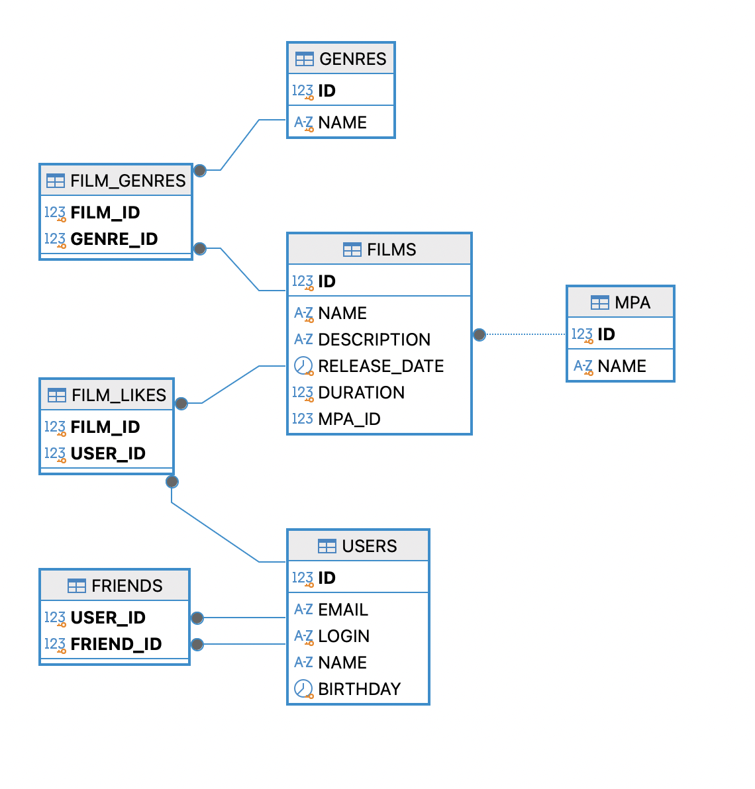

# java-filmorate
## Схема базы данных
В проекте используется реляционная база данных. Ниже представлена структура таблиц, типы данных и связи между ними.



## Таблицы

* `users` — данные о зарегистрированных пользователях сервиса.
* `films` — данные о фильмах, добавленных в систему.
* `mpa` — справочник возрастных рейтингов Американской киноассоциации (например: G, PG, PG-13, R, NC-17).
* `genres` — справочник жанров кино (например: Комедия, Драма, Боевик).
* `film_genres` — таблица связей many-to-many между фильмами и жанрами.
* `film_likes` — таблица связей many-to-many для хранения лайков от пользователей к фильмам.
* `friends` — таблица связей между пользователями.

#### 1. Таблица `users` (Пользователи)

| Поле       | Тип данных | Описание                              |
|:-----------|:-----------|:--------------------------------------|
| `id` (PK)  | BIGINT     | Уникальный идентификатор пользователя |
| `email`    | VARCHAR    | Электронная почта                     |
| `login`    | VARCHAR    | Логин пользователя                    |
| `name`     | VARCHAR    | Имя пользователя                      |
| `birthday` | DATE       | Дата рождения                         |

#### 2. Таблица `films` (Фильмы)

| Поле           | Тип данных   | Описание                                                |
|:---------------|:-------------|---------------------------------------------------------|
| `id` (PK)      | BIGINT       | Уникальный идентификатор фильма                         |
| `name`         | VARCHAR      | Название фильма                                         |
| `description`  | VARCHAR(200) | Описание фильма                                         |
| `release_date` | DATE         | Дата релиза                                             |
| `duration`     | INTEGER      | Продолжительность фильма в минутах                      |
| `mpa_id` (FK)  | INTEGER      | Идентификатор возрастного рейтинга (ссылка на `mpa.id`) |

#### 3. Таблица `mpa` (Рейтинги MPA)

| Поле       | Тип данных | Описание                             |
|:-----------|:-----------|:-------------------------------------|
| `id` (PK)  | INTEGER    | Уникальный идентификатор рейтинга    |
| `name`     | VARCHAR    | Название рейтинга (G, PG, R и т.д.)  |

#### 4. Таблица `genres` (Жанры)

| Поле       | Тип данных | Описание                        |
|:-----------|:-----------|:--------------------------------|
| `id` (PK)  | INTEGER    | Уникальный идентификатор жанра  |
| `name`     | VARCHAR    | Название жанра                  |

#### 5. Таблица `film_genres` (Жанры фильмов)

| Поле                | Тип данных | Описание                                     |
|:--------------------|:-----------|:---------------------------------------------|
| `film_id` (PK, FK)  | BIGINT     | Идентификатор фильма (ссылка на `films.id`)  |
| `genre_id` (PK, FK) | INTEGER    | Идентификатор жанра (ссылка на `genres.id`)  |

#### 6. Таблица `film_likes` (Лайки фильмов)

| Поле                | Тип данных | Описание                                          |
|:--------------------|:-----------|:--------------------------------------------------|
| `film_id` (PK, FK)  | BIGINT     | Идентификатор фильма (ссылка на `films.id`)       |
| `user_id` (PK, FK)  | BIGINT     | Идентификатор пользователя (ссылка на `users.id`) |

#### 7. Таблица `friends` (Друзья)

| Поле                 | Тип данных | Описание                                                        |
|:---------------------|:-----------|:----------------------------------------------------------------|
| `user_id` (PK, FK)   | BIGINT     | Идентификатор инициатора дружбы (ссылка на `users.id`)          |
| `friend_id` (PK, FK) | BIGINT     | Идентификатор подтверждающего друга (ссылка на `users.id`)      |


## Примеры запросов
```
SELECT * FROM users;
SELECT * FROM users WHERE id = ?;

INSERT INTO users(email, login, name, birthday)
VALUES (?, ?, ?, ?);

UPDATE users
SET email = ?, login = ?, name = ?, birthday = ?
WHERE id = ?;

INSERT INTO film_likes (film_id, user_id)
VALUES (?, ?);

DELETE FROM film_likes WHERE film_id = ? AND user_id = ?;

SELECT u.* 
FROM friends AS f
LEFT JOIN users AS u ON f.friend_id = u.id
WHERE f.user_id = ?;
                    
SELECT u.* 
FROM users AS u 
JOIN friends AS f1 ON u.id = f1.friend_id 
JOIN friends AS f2 ON f1.friend_id = f2.friend_id 
WHERE f1.user_id = ? AND f2.user_id = ?;

INSERT INTO film_genres (film_id, genre_id)
VALUES (?, ?);

DELETE FROM film_genres WHERE film_id = ?;
```