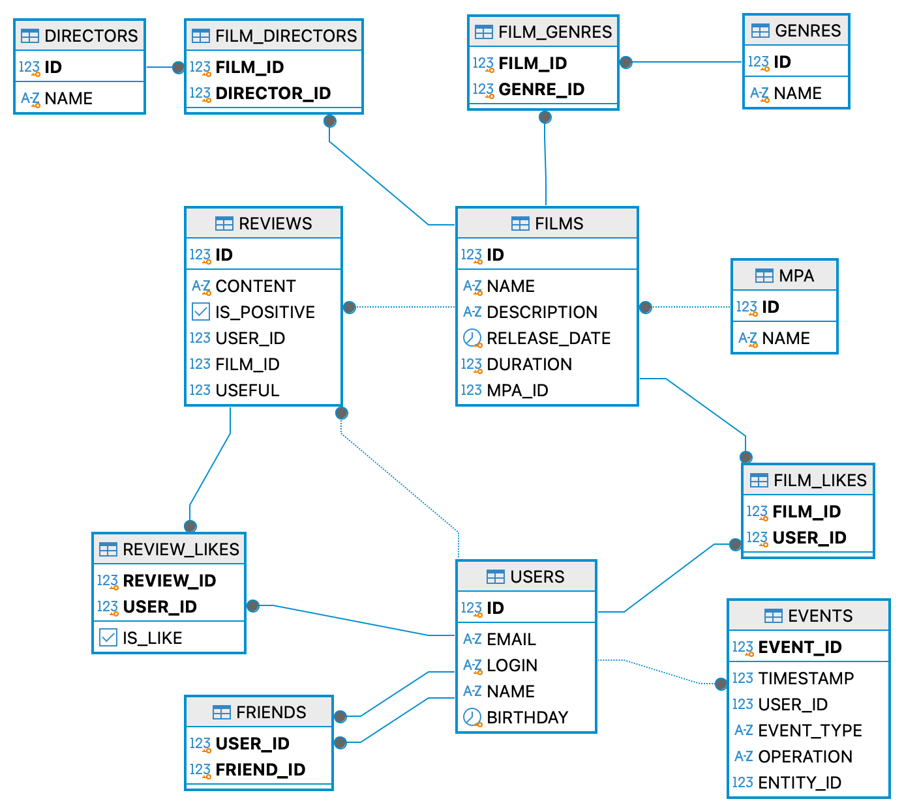

# java-filmorate

## Схема базы данных

В проекте используется реляционная база данных. Ниже представлена структура таблиц, типы данных и связи между ними.

## Таблицы

* `users` — данные о зарегистрированных пользователях сервиса.
* `films` — данные о фильмах, добавленных в систему.
* `mpa` — справочник возрастных рейтингов Американской киноассоциации (например: G, PG, PG-13, R, NC-17).
* `genres` — справочник жанров кино (например: Комедия, Драма, Боевик).
* `film_genres` — таблица связей many-to-many между фильмами и жанрами.
* `film_likes` — таблица связей many-to-many для хранения лайков от пользователей к фильмам.
* `friends` — таблица связей между пользователями.
* `directors` — данные о режиссёрах.
* `film_directors` — таблица связей many-to-many между фильмами и режиссёрами.
* `reviews` — отзывы пользователей на фильмы.
* `review_likes` — лайки и дизлайки отзывов.
* `events` — лента событий.

#### 1. Таблица `users` (Пользователи)

| Поле       | Тип данных | Описание                              |
|:-----------|:-----------|:--------------------------------------|
| `id` (PK)  | BIGINT     | Уникальный идентификатор пользователя |
| `email`    | VARCHAR    | Электронная почта                     |
| `login`    | VARCHAR    | Логин пользователя                    |
| `name`     | VARCHAR    | Имя пользователя                      |
| `birthday` | DATE       | Дата рождения                         |

#### 2. Таблица `films` (Фильмы)

| Поле           | Тип данных   | Описание                                                |
|:---------------|:-------------|---------------------------------------------------------|
| `id` (PK)      | BIGINT       | Уникальный идентификатор фильма                         |
| `name`         | VARCHAR      | Название фильма                                         |
| `description`  | VARCHAR(200) | Описание фильма                                         |
| `release_date` | DATE         | Дата релиза                                             |
| `duration`     | INTEGER      | Продолжительность фильма в минутах                      |
| `mpa_id` (FK)  | INTEGER      | Идентификатор возрастного рейтинга (ссылка на `mpa.id`) |

#### 3. Таблица `mpa` (Рейтинги MPA)

| Поле       | Тип данных | Описание                            |
|:-----------|:-----------|:------------------------------------|
| `id` (PK)  | INTEGER    | Уникальный идентификатор рейтинга   |
| `name`     | VARCHAR    | Название рейтинга (G, PG, R и т.д.) |

#### 4. Таблица `genres` (Жанры)

| Поле       | Тип данных | Описание                       |
|:-----------|:-----------|:-------------------------------|
| `id` (PK)  | INTEGER    | Уникальный идентификатор жанра |
| `name`     | VARCHAR    | Название жанра                 |

#### 5. Таблица `film_genres` (Жанры фильмов)

| Поле                | Тип данных | Описание                                    |
|:--------------------|:-----------|:--------------------------------------------|
| `film_id` (PK, FK)  | BIGINT     | Идентификатор фильма (ссылка на `films.id`) |
| `genre_id` (PK, FK) | INTEGER    | Идентификатор жанра (ссылка на `genres.id`) |

#### 6. Таблица `film_likes` (Лайки фильмов)

| Поле                | Тип данных | Описание                                          |
|:--------------------|:-----------|:--------------------------------------------------|
| `film_id` (PK, FK)  | BIGINT     | Идентификатор фильма (ссылка на `films.id`)       |
| `user_id` (PK, FK)  | BIGINT     | Идентификатор пользователя (ссылка на `users.id`) |

#### 7. Таблица `friends` (Друзья)

| Поле                 | Тип данных | Описание                                                   |
|:---------------------|:-----------|:-----------------------------------------------------------|
| `user_id` (PK, FK)   | BIGINT     | Идентификатор инициатора дружбы (ссылка на `users.id`)     |
| `friend_id` (PK, FK) | BIGINT     | Идентификатор подтверждающего друга (ссылка на `users.id`) |

#### 8. Таблица `directors` (Режиссёры)

| Поле      | Тип данных | Описание                           |
|:----------|:-----------|:-----------------------------------|
| `id` (PK) | BIGINT     | Уникальный идентификатор режиссёра |
| `name`    | VARCHAR    | Имя режиссёра                      |

#### 9. Таблица `film_directors` (Режиссёры фильмов)

| Поле                   | Тип данных | Описание                                            |
|:-----------------------|:-----------|:----------------------------------------------------|
| `film_id` (PK, FK)     | BIGINT     | Идентификатор фильма (ссылка на `films.id`)         |
| `director_id` (PK, FK) | BIGINT     | Идентификатор режиссёра (ссылка на `directors.id`)  |

#### 10. Таблица `reviews` (Отзывы)

| Поле           | Тип данных | Описание                                                                |
|:---------------|:-----------|:------------------------------------------------------------------------|
| `id` (PK)      | BIGINT     | Уникальный идентификатор отзыва                                         |
| `content`      | VARCHAR    | Текст отзыва                                                            |
| `is_positive`  | BOOLEAN    | Тип отзыва (`true` — положительный, `false` — отрицательный)            |
| `user_id` (FK) | BIGINT     | Идентификатор автора отзыва (ссылка на `users.id`)                      |
| `film_id` (FK) | BIGINT     | Идентификатор фильма, к которому оставлен отзыв (ссылка на `films.id`)  |
| `useful`       | INTEGER    | Рейтинг полезности отзыва (по умолчанию `0`)                            |

#### 11. Таблица `review_likes` (Оценки отзывов)

| Поле                 | Тип данных | Описание                                                     |
|:---------------------|:-----------|:-------------------------------------------------------------|
| `review_id` (PK, FK) | BIGINT     | Идентификатор отзыва (ссылка на `reviews.id`)                |
| `user_id` (PK, FK)   | BIGINT     | Идентификатор пользователя (ссылка на `users.id`)            |
| `is_like`            | BOOLEAN    | Тип оценки (`true` — лайк, `false` — дизлайк)                |

#### 12. Таблица `events` (Лента событий)

| Поле            | Тип данных  | Описание                                                                        |
|:----------------|:------------|:--------------------------------------------------------------------------------|
| `event_id` (PK) | BIGINT      | Уникальный идентификатор события                                                |
| `timestamp`     | BIGINT      | Временная метка совершения действия (в миллисекундах)                           |
| `user_id` (FK)  | BIGINT      | Идентификатор пользователя, совершившего действие (ссылка на `users.id`)        |
| `event_type`    | VARCHAR(10) | Тип сущности, с которой связано событие (`LIKE`, `REVIEW`, `FRIEND`)            |
| `operation`     | VARCHAR(10) | Тип выполненной операции (`REMOVE`, `ADD`, `UPDATE`)                            |
| `entity_id`     | BIGINT      | Идентификатор сущности, над которой совершено действие (фильм, отзыв или друг)  |

## Примеры запросов

```
-- Пользователи
SELECT * FROM users;
SELECT * FROM users WHERE id = ?;
INSERT INTO users(email, login, name, birthday) VALUES (?, ?, ?, ?);
UPDATE users SET email = ?, login = ?, name = ?, birthday = ? WHERE id = ?;

-- Лайки и жанры фильмов
INSERT INTO film_likes (film_id, user_id) VALUES (?, ?);
DELETE FROM film_likes WHERE film_id = ? AND user_id = ?;
INSERT INTO film_genres (film_id, genre_id) VALUES (?, ?);
DELETE FROM film_genres WHERE film_id = ?;

-- Друзья
SELECT u.* FROM friends AS f LEFT JOIN users AS u ON f.friend_id = u.id WHERE f.user_id = ?;
SELECT u.* FROM users AS u JOIN friends AS f1 ON u.id = f1.friend_id JOIN friends AS f2 ON f1.friend_id = f2.friend_id WHERE f1.user_id = ? AND f2.user_id = ?;

-- Режиссёры
SELECT * FROM directors;
SELECT * FROM directors WHERE id = ?;
INSERT INTO directors (name) VALUES (?);
UPDATE directors SET name = ? WHERE id = ?;
DELETE FROM directors WHERE id = ?;
INSERT INTO film_directors (film_id, director_id) VALUES (?, ?);
DELETE FROM film_directors WHERE film_id = ?;

-- Отзывы и их оценки
INSERT INTO reviews (content, is_positive, user_id, film_id) VALUES (?, ?, ?, ?);
UPDATE reviews SET content = ?, is_positive = ? WHERE id = ?;
DELETE FROM reviews WHERE id = ?;
SELECT * FROM reviews WHERE film_id = ? ORDER BY useful DESC LIMIT ?;
INSERT INTO review_likes (review_id, user_id, is_like) VALUES (?, ?, ?);
DELETE FROM review_likes WHERE review_id = ? AND user_id = ?;
UPDATE reviews SET useful = useful + ? WHERE id = ?;

-- Лента событий
INSERT INTO events (timestamp, user_id, event_type, operation, entity_id) VALUES (?, ?, ?, ?, ?);
SELECT * FROM events WHERE user_id = ? ORDER BY event_id;
```